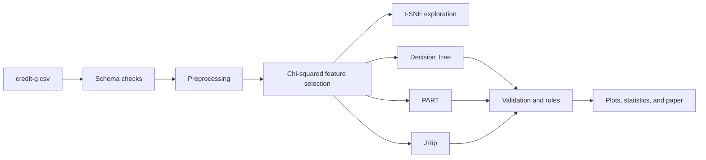
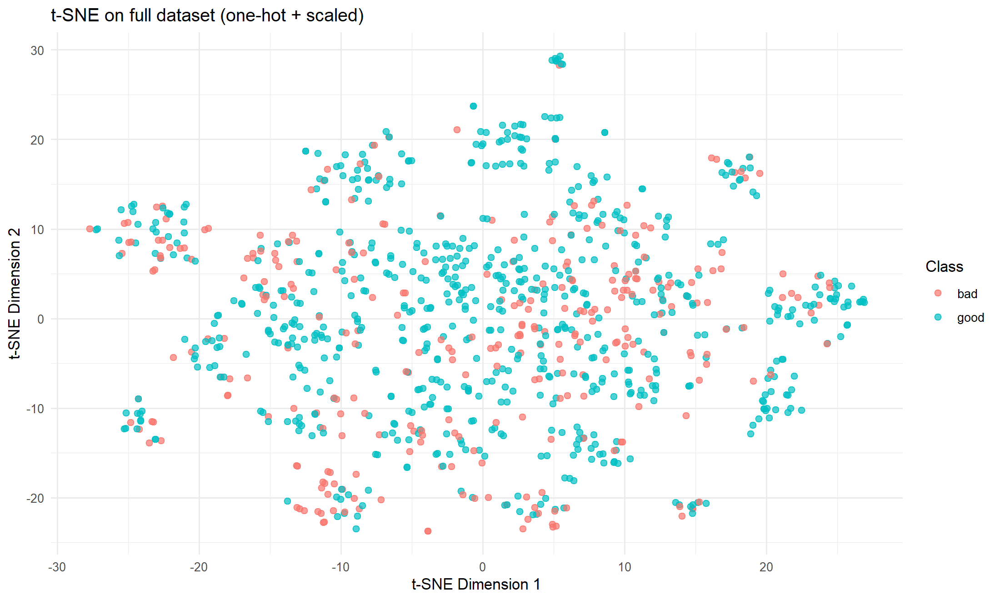
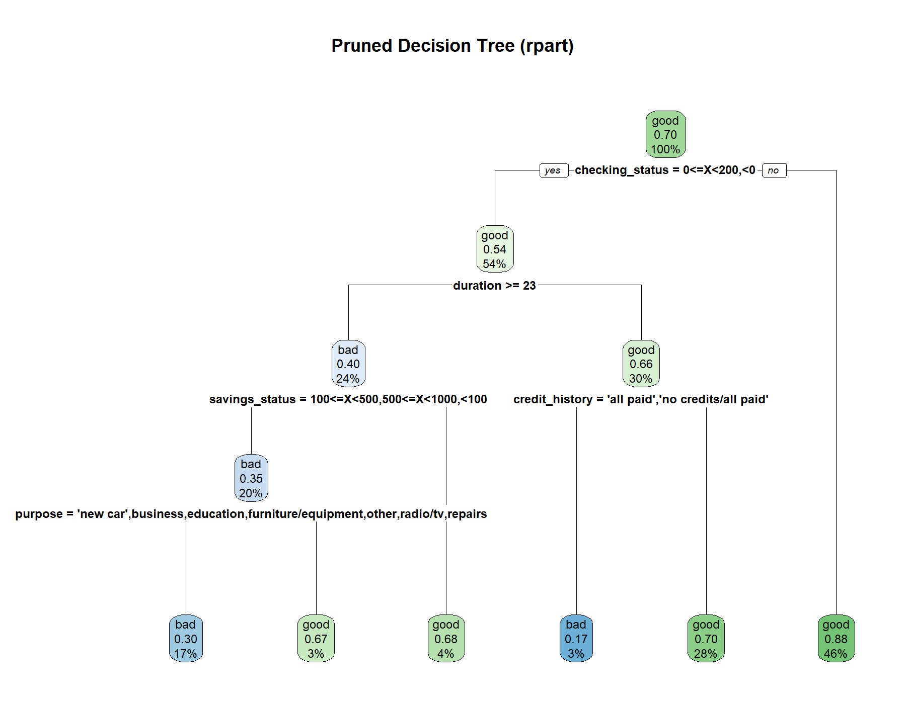
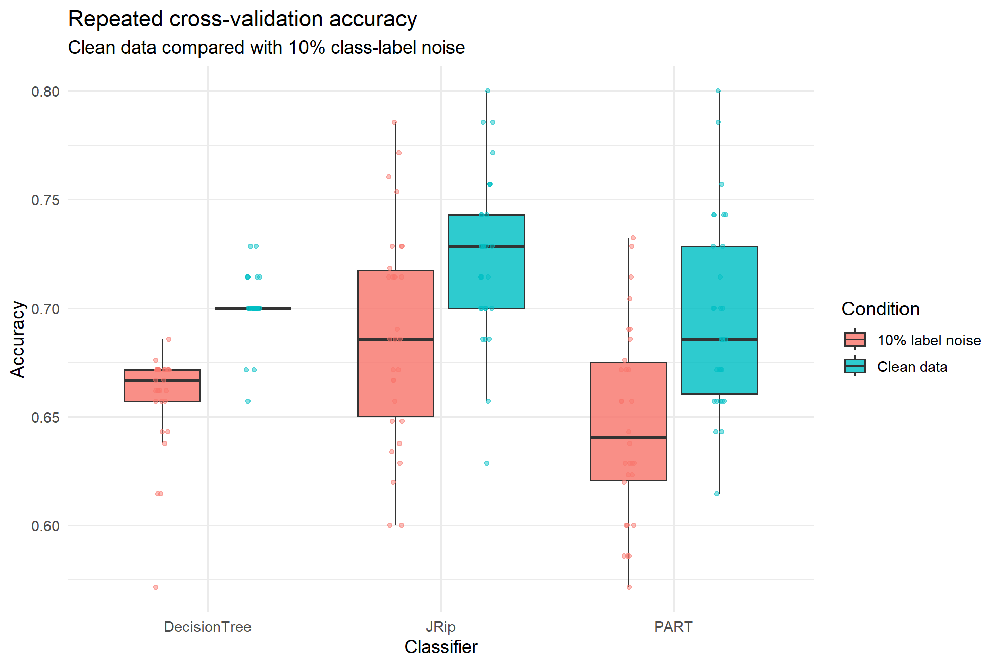

# Credit Risk Classification with Rule Induction


An R-based study of interpretable credit-risk classifiers using the Statlog German Credit dataset. The project compares a pruned Decision Tree, PART, and RIPPER/JRip while keeping the learned decision rules visible and auditable.

## At a Glance

| Dataset | Observations | Predictors | Target |
|---|---:|---:|---|
| Statlog German Credit | 1,000 | 20 | 700 good / 300 bad |

| Evaluation | Models | Validation |
|---|---|---|
| Classification and robustness | Decision Tree, PART, JRip | Repeated 10-fold validation with 10% label noise |

## Analysis Flow



The workflow validates the input, removes duplicate rows, aligns factor levels, selects the 15 strongest attributes, creates the t-SNE view, trains the three rule-based models, and evaluates clean and noisy data with fixed seeds.

## Results

| Model | Clean mean | Noisy mean | Rules | Final rank |
|---|---:|---:|---:|---:|
| **JRip** | **0.7238** | **0.6881** | **4** | **1** |
| Decision Tree | 0.7010 | 0.6586 | 6 | 2 |
| PART | 0.6967 | 0.6466 | 44 | 3 |

JRip has the highest mean accuracy in both conditions, the smallest accuracy drop under label noise, and the shortest rule base. The Decision Tree has the smallest clean-data variance and is the most stable across clean validation folds. PART produces the longest rule list and ranks third in the combined comparison.

## Visual Results

| t-SNE representation | Pruned decision tree |
|---|---|
|  |  |



*The plots above are generated by the project R script and stored in `plots/`.*

## Project Files

| Path | Description |
|---|---|
| `credit_risk_classification_rule_induction.R` | Complete analysis workflow |
| `credit-g.csv` | German Credit dataset |
| `credit_risk_classification_research_paper.pdf` | Research paper |
| `plots/` | Current t-SNE, tree, and validation plots |
| `rule_files/` | Decision Tree, PART, and JRip rule outputs |

The LaTeX source files remain available locally for paper editing and are excluded from version control.

## Reproduction

Run the following command from the project root. Required packages include `rpart`, `rpart.plot`, `caret`, `RWeka`, `FSelector`, `Rtsne`, `ggplot2`, `dplyr`, and `tibble`.

```bash
Rscript credit_risk_classification_rule_induction.R
```
